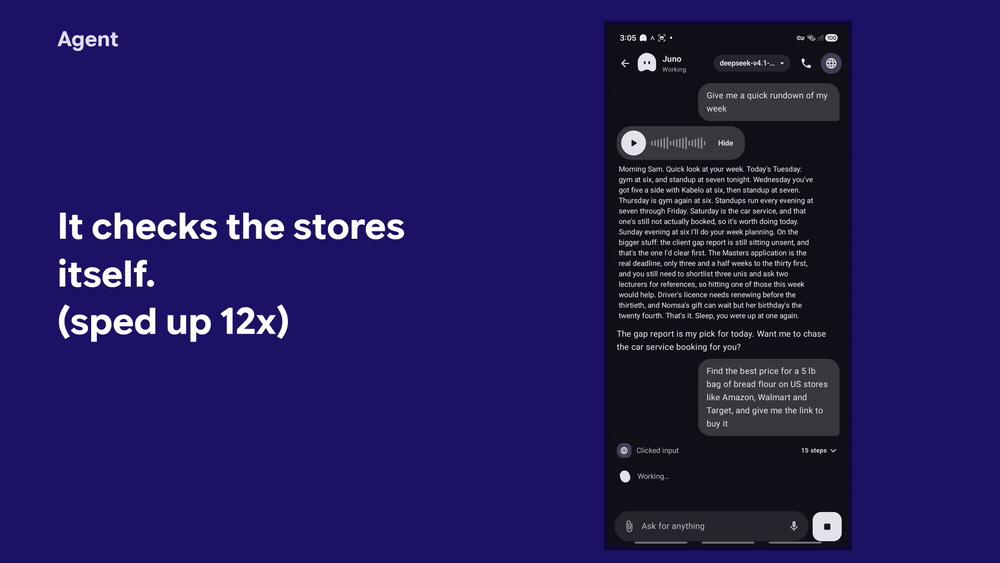
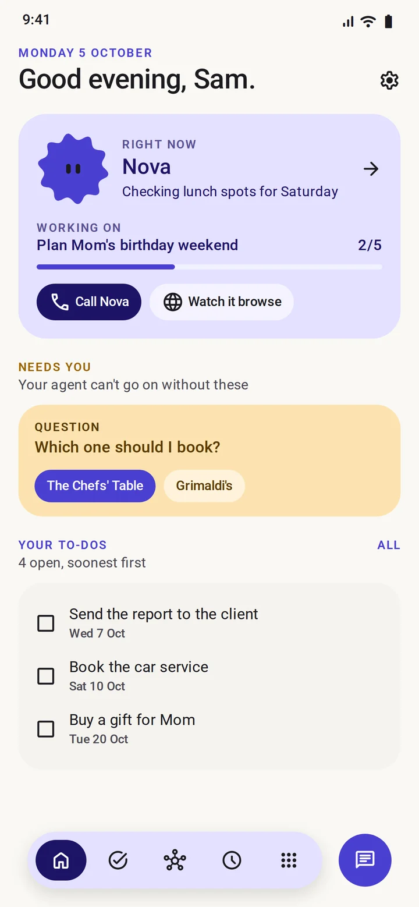
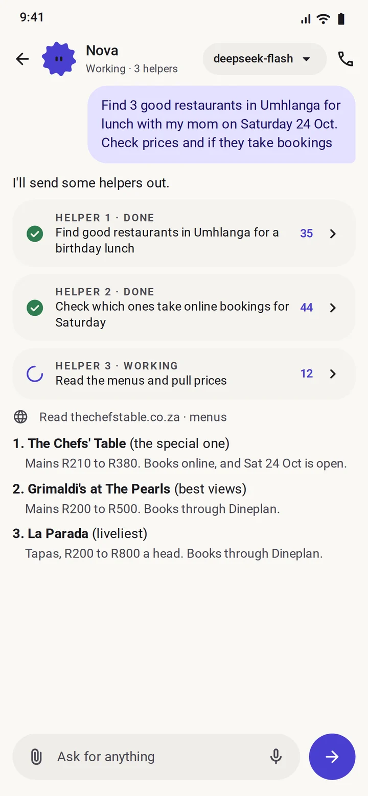
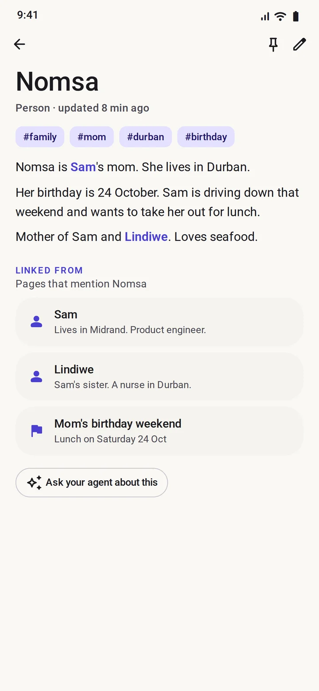
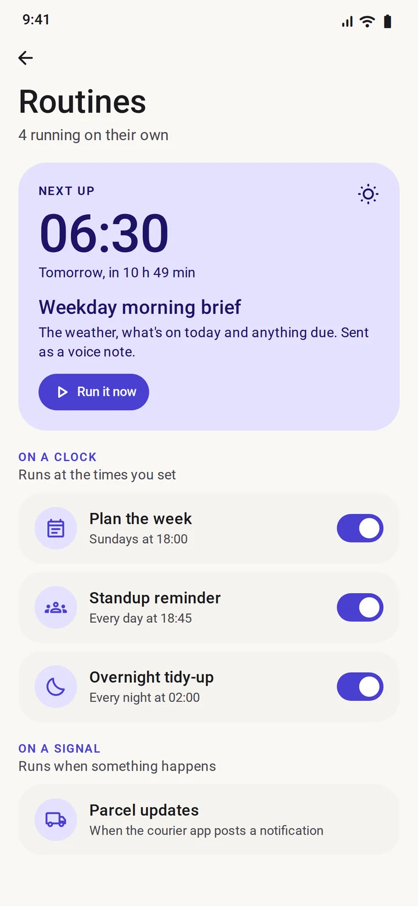

# Agent

An autonomous, always-on agent that is yours alone. It has its own browser, keeps a wiki memory of everything it learns
about you, and hands the heavy jobs to your own machines.

It lives in two places, and you can use either or both: **on your phone**, or **on your computer with the phone as the
window**. Same agent, same memory, same approvals; the heavy work and the keys stay where you put them.

You bring the model. Paste an API key, or sign in with the ChatGPT or Claude plan you already pay for.

[Get the APK](https://github.com/Past-da-king/agent/releases/latest) | [Get the desktop app](https://github.com/Past-da-king/agent-desktop-app/releases/latest) | [Build it from source](#build-from-source)

Free and open source, MIT. No account, no subscription, no server of ours.

## What it looks like

   

Home, chat, memory, routines. The two demo recordings are on the [project page](https://past-da-king.github.io/agent/).

## Install

It is not on the Play Store. You sideload the APK.

1. Open [Releases](https://github.com/Past-da-king/agent/releases/latest) and download the latest `Agent-*.apk` on your phone.
2. Tap the file and allow the install when Android asks. That is the whole sideload.
3. Open Agent, give it a name, pick how it looks, then pick how to power it. See [Setup](#setup).
4. On a Samsung, Xiaomi or OnePlus phone, set the app's battery to **Unrestricted** under Settings, or Android will kill the browser and the routines while they work.

You need Android 8 or newer on an arm64 phone, which is every phone sold in the last few years. The APK is about 36 MB
without the bundled subscription runtimes, and about 360 MB with them, so leave room for it and for its data.

## Two ways to run it

**On the phone.** The agent loop, the browser, memory, tasks and routines all run in the app. Nothing else is needed, and
no other computer has to exist.

**On your computer, with the phone as the window.** Pair the phone with the desktop app (Settings, Devices, Add a device).
From then on the phone shows the same chats, cards, approvals and reports, and the work runs on the computer with its
accounts, its files and its bigger keys. It behaves like one agent, not two:

- **The phone knows which computer is answering.** A message goes to the brain that should take it; if that computer says
  nothing within a few seconds, the next one gets the same message id, so the work still runs exactly once.
- **A card is only "working" while the computer that published it is answering.** A stopped machine says so instead of
  spinning.
- **Your computer's files stay on your computer.** When the agent shows a video or a picture, the phone asks for exactly the
  part of the file it needs, by a token the computer made for that one card, and nothing else is reachable.

## What it can actually do

**It goes and looks.** The agent drives its own built-in browser. It cannot control your existing Chrome tabs, so you sign in to your sites inside it. That browser runs in a foreground service, so it keeps working while you are in another app or the screen is off. When a site throws a captcha or a sign-in at it, it hands the page to you and carries on when you are done. Profiles keep Personal and Work apart, and helper agents can split a big job up.

**It remembers you.** Everything it learns gets a page in a wiki, linked to the pages around it. Read it, change it, pin it or delete it. Nothing is kept that you cannot see.

**It answers in cards, not walls of text.** A table, a chart, a set of steps, a row of buttons, one card per listing: the answer is something you can read at a glance, tap, and edit. Pictures and videos the agent finds or makes play inside the chat.

**It runs on a clock.** A routine can fire at a set time, on a new email, or the moment an app you chose sends a notification. It can watch a price for weeks and only speak up when it actually moves. A routine works with the same tools the agent has, including your task list.

**It learns the web apps you use.** Show it a site once and it can write its own tools for that site, so the next visit is one call instead of a hundred clicks. You decide whether those tools may act without asking.

**It builds little apps for you.** A mini-app is a small dashboard or tracker it makes and keeps up to date, on the phone and on the computer, with only the permissions you grant it.

**It uses the accounts you have.** Apps connect through [Composio](https://composio.dev) with your own key: Gmail, Calendar, Drive, Slack and a few hundred more. It asks to connect one only when a job needs it, and the sign-in opens inside the app. You can hold several accounts per app, like two Outlooks or four Gmails.

**It hands heavy work to a real computer.** Any server or PC you can SSH into becomes a machine it can use. Run a command, start a long job that keeps going in the background, move files both ways. Looking around just runs. Anything that changes the machine shows you the exact command first.

**It answers in voice, and reads your files.** Voice notes in and out, live calls if you add a Gemini key, photos and documents in chat, including scanned PDFs read on the device.

**It tidies up overnight.** At 02:00, and only while charging and online, it sorts its memory, writes notes from the day and builds your morning screen.

**It waits for your yes.** Anything that spends money or sends something in your name stops at an approve button.

## What it is not

- Not a product. No account, no subscription, nobody to pay.
- Not on the Play Store, so nobody at Google has looked at it. Read the source, or build it yourself, if that matters to you.
- Not finished. It has mostly been tested on one Samsung phone, and the phone-and-computer pairing is the newest part.
- Not faultless. It is an agent with a browser and access to whatever you connect, so it will get things wrong. Read what you approve.
- Not for everyone yet. It expects you to be comfortable sideloading an APK and pasting a key.

## Permissions and privacy

Nothing is read until you allow it. Location, files, notifications and the rest are asked for at the moment a job needs them, and the app runs with all of them denied. The one most people want is notifications, and even then you pick the apps it may read, one at a time, and take it back whenever you like.

- Keys are stored on the phone in `EncryptedSharedPreferences`, locked by the Android Keystore.
- Memory, tasks, routines and chat live in a Room database on the phone.
- Traffic leaves the phone only to the model you picked, the sites the agent browses, Composio if you added a key, your voice provider if you added one, and the computers you paired.
- Machine secrets stay encrypted on the phone and the agent only ever sees a machine's name. A machine is pinned the first time you connect, and refused if its identity changes later.
- A file the agent shows you is served by the computer that holds it, to the paired phone, by an opaque token with no path in it, read-only. A made up token gets nothing.

## Star it if you want it to exist

If an agent that lives on your own hardware and answers to you is something you want to keep existing, [give the repo a star](https://github.com/Past-da-king/agent). It is the only signal this project has, and it is what puts Agent in front of the next person looking for it.

## Setup

Onboarding walks you through this. In order:

1. **Name and style.** Name your agent, pick a colour and a face. The face becomes the app's icon.
2. **Power.** Choose one:

   | Option | What you need | Notes |
   |---|---|---|
   | Your own computer | The Agent desktop app with Devices turned on | The phone becomes the window; nothing to pay, keys stay on the computer |
   | API key | A key from DeepSeek, OpenRouter, Gemini, Claude, OpenAI or OpenCode (Zen or Go) | Runs in the app's own agent loop. Quickest to set up. |
   | Any OpenAI-compatible endpoint | Base URL, model name and a key | Hosted services, or your own server. See [Self-hosted servers](#self-hosted-servers-ollama-lm-studio-vllm). |
   | ChatGPT subscription | A ChatGPT account (the free tier worked in testing) | Runs Codex on the phone through the bundled runtime. Sign in inside the app. |
   | Claude subscription | Claude Pro or Max | Runs Claude Code on the phone through the bundled runtime. Read [Risks](#risks) first. |

   Once a key is checked you can pick the model, and switch from the chip at the top of the chat at any time.
3. **Connections, if you want them.** Paste your Composio API key under **Connections**, then connect the apps you use. The agent can also ask for one mid-job, and that sign-in opens inside the app's browser.
4. **Voice, if you want it.** Under **Settings, Voice**, add a Gemini, OpenAI or ElevenLabs key for spoken replies. A Gemini key also turns on live calls.
5. **Notifications, if you want them.** Choose which apps the agent may read. Nothing is read until you pick.

## Self-hosted servers (Ollama, LM Studio, vLLM)

Pick **Other (OpenAI-compatible)**, then enter the server's base URL, usually ending in `/v1`, the model name and a key. Any placeholder works if your server does not check keys.

- **HTTPS is the default and the way to do it.** Put the server behind a reverse proxy with a certificate such as Caddy or nginx, or use `tailscale serve` to get an `https://` address on your tailnet.
- **Plain HTTP on your LAN** (`http://192.168.1.20:8080/v1` and the like) is blocked unless you opt in. When the URL starts with `http://` you get a warning and a checkbox, *Allow unencrypted HTTP for this server*. Requests and your API key then travel in clear text, so only tick it on a network you trust. The opt-in is saved with that server and cleared when you switch provider.
- Built-in providers always use HTTPS.

## Machines, over SSH

Your phone can be the remote, not the engine. Under **Connections, Machines** you can add any computer you can SSH into: a VPS, a university or work server, your own PC.

- **Sign in** with a password, a private key you already use, or a new key made on the phone. You paste its public half into `~/.ssh/authorized_keys` once, and no password is stored.
- **Through a gateway**, so a machine behind a login host can be reached as well.
- **Commands that change things ask first.** The card shows the exact command, unless you switch on *Run without asking* for that machine.
- **At home**, put the phone and the computer on the same [Tailscale](https://tailscale.com) network and use the computer's tailnet address. On Windows, turn on *OpenSSH Server* under Settings, Optional features, or run `sshd` inside WSL.

## Connect other apps: intents, MacroDroid, Tasker

The agent talks to the other apps on your phone the way Android apps talk to each other, with intents, and other apps can talk to it the same way. Everything stays on the phone.

### Agent to any app

Two tools do this.

- `android_apps` shows what is installed and what each app accepts: links, places, shared text and images, and its exported screens. It only reads, so it never asks.
- `android_intent` sends an intent: `{kind: broadcast | activity | service, action, package, component, data, mimeType, category, extras, flags}`. Extras keep their type (text, true or false, numbers, lists), or you force one with `{type, value}`.

A Google Maps route, for example:

```
{kind: "activity", action: "android.intent.action.VIEW", data: "google.navigation:q=Sandton+City", package: "com.google.android.apps.maps"}
```

What asks first:

- An intent that only opens a screen goes straight away: view a link or a place, open an app, the dialler with a number filled in, a search, a settings page.
- Anything else asks you first: sharing into an app, a broadcast, a service.
- To stop being asked for one, add its action and app to Settings, Automation, *Agent talks to your apps*, **Allowed app intents**, one per line: `android.intent.action.SEND | com.whatsapp`. Use `*` for any app. The approval card shows the exact line.
- When nobody is there to answer, as in a routine at night, it is not sent.

Android does not let an app open a screen from the background. If the Agent app is not on screen, the intent arrives as a notification you tap. Allow *Display over other apps* for Agent to skip that.

### Agent to MacroDroid or Tasker

`macrodroid_run` is a preset over the same thing: one broadcast your macro listens for.

1. In MacroDroid, make a macro with the trigger **Intent Received**.
2. Action: `com.past9.phoneaos.MACRO`, exactly. It is case-sensitive.
3. Add one extra. Name: `macro`, in small letters. Value: the macro's name, for example `demo`, with nothing after it, not even a space.
4. Optional: `v1`, `v2`, `v3` and `params` = `*`, each saved to a variable. The agent always sends all of them as text.
5. In the Agent app, open Settings, Automation, *Agent talks to your apps*, and add `demo` to **Allowed macros**. Macros on that list run without asking. Any other macro asks first.
6. Tap **Send** under *Test a macro*. It sends the first macro on your list.

If the macro does not run, MacroDroid gives no error. Check these, in order:

- MacroDroid is switched on, and so is the macro.
- The extra's name is `macro`, not `Macro`. Phone keyboards capitalise it. The agent also sends `Macro` and `MACRO`, so this one is covered from 0.15.32.
- The value has no space after it. Predictive keyboards add one, and then it never matches. `demo*` also works.
- Remove the extra and test with the action alone. If that fires, the extra was the problem.

Tasker catches the same broadcast: Profile, Event, *Intent Received*, Action `com.past9.phoneaos.MACRO`. The values arrive as `%macro`, `%v1`, `%v2`, `%v3` and `%params`.

The **MacroDroid webhook** is optional and off by default. It lets an agent that is not on this phone reach MacroDroid's own server, `trigger.macrodroid.com`. Your values then pass through MacroDroid's server, so leave it off unless you need it.

### Any app to Agent

Two doors, with the same token and the same switch (Settings, Automation, *Automation from other apps*, **Allow outside runs**). A run started from outside has nobody watching, so anything that needs your approval is refused.

- **By intent.** Send a broadcast to package `com.past9.phoneaos` with action `com.past9.phoneaos.RUN_ROUTINE` and the extras `token` and `routine` (its name or id), plus an optional `note`. Or action `com.past9.phoneaos.INSTRUCT` with `token` and `text`. This works when the Agent app is closed. The package is required, because Android does not deliver a broadcast to a closed app without it. The sheet has a recipe to copy, with your token in it.
- **Over HTTP.** `http://127.0.0.1:47321` with the token as a Bearer header, only while the app is running. This one can also read the result back. Steps: [docs/automation-macrodroid.md](docs/automation-macrodroid.md).

### From your computer

The agent on a linked computer can use `android_intent`, `android_apps` and `macrodroid_run` on the phone through the device link, with the same allowlists and the same question on the phone. Switch it off under Settings, Linked devices.

## Sites that need advanced browser features

WhatsApp Web calls, in-browser editors and models that run in the page need shared memory (SharedArrayBuffer), which Android's WebView hides unless the app names the site. Settings, Browser, *Sites that need advanced browser features* is your list: `https://web.whatsapp.com` to start with, exact https sites only, no wildcards. In the same sheet, **Let the agent speak in WhatsApp calls** (off by default) lets the agent's live voice go into a WhatsApp Web call it places: `place_whatsapp_call` places a whole call and returns what was said, `browser_call_voice` does the steps by hand. **Turn on calling for a test account** (off by default, with a ban-risk warning) is for a test number WhatsApp has not given calling to, never your main number. Details and the check to run on the phone: [docs/browser-advanced-features.md](docs/browser-advanced-features.md).

## Build from source

You need JDK 17, the Android SDK (compileSdk 37), and for the runtime pack `curl`, `ar`, `patchelf` and Node/npm.

```bash
git clone https://github.com/Past-da-king/agent
cd agent
# Downloads Termux's Node build, Codex and ripgrep and packs them as jniLibs plus assets,
# which are git-ignored. Only needed for the subscription paths. API keys work without it.
./tools/build-runtime-pack.sh
./gradlew assembleDebug
adb install -r app/build/outputs/apk/debug/app-debug.apk
```

Release builds are signed from a properties file that is never in this repository: pass `-PsigningProps=<file>`.

Tests: `./gradlew testDebugUnitTest`, which runs the unit tests plus Robolectric and Roborazzi screenshots in light and dark.

## How it works, in short

- Kotlin and Jetpack Compose (Material 3 Expressive), Room, WorkManager.
- On the API key path, a provider-neutral agent loop in Kotlin that speaks both chat formats.
- On the subscription path, Node 24 (Termux's Android build) ships inside the APK as `lib*.so` files, because Android only lets an app execute files from its native library folder, and the Agent SDK runs on it. Codex and Claude Code ship the same way as their arm64 musl builds; Claude Code gets the musl loader as `libldmusl.so`, and a local proxy resolves DNS for both. The app's own tools are served to them over a local MCP server on `127.0.0.1` with a per-install token.
- The browser is an Android WebView hosted in a foreground service.
- With a computer paired, the phone and the computer replicate chats, tasks and memory over an encrypted link of their own: no relay of ours, no account.

## Risks

- **Your own risk.** The agent can browse, fill in forms, read the notifications you allow and act in the apps you connect. Approvals guard payments and sends, so check what you approve.
- **The Claude subscription login is not officially sanctioned.** The option is there because it works. Using it is a call you make about your own account. A Claude API key is the safe way to use those models here.
- **Sideloaded.** It is not reviewed by Google.
- **Battery.** Background browsing and routines use battery. The overnight routine only runs while charging.
- **Early software.** Tested mainly on one Samsung phone.

## History

This repository started as an early version of the app and carries the work of its contributors. The line that has been
shipping since was developed privately and was merged into `main` in November 2026, keeping the earlier history and the
licence intact. See [Releases](https://github.com/Past-da-king/agent/releases) for what changed when.

## License

MIT. See [LICENSE](LICENSE).
